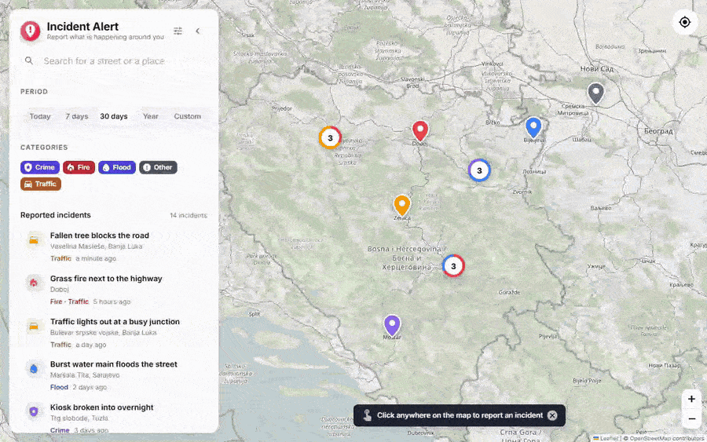
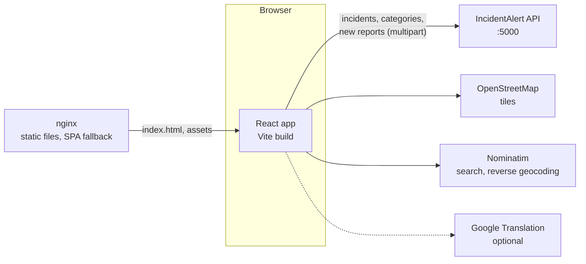

<div align="center">

# 📍 Incident Alert — Public App

[](https://github.com/pero-grubac/IncidentAlertFrontend/actions/workflows/ci.yml)


**See what is happening around you on a map, and report it — with photos — in a few clicks.**



</div>

---

## 📌 Project Overview

The public web app of **Incident Alert**. Anyone can browse approved incidents on the map, open a place to see everything reported there, and report something new. Reports go to a moderator first and appear on the map once approved.

It talks to the **IncidentAlert** API from the [backend repository](https://github.com/pero-grubac/IncidentAlert). Moderators use the separate [moderation app](https://github.com/pero-grubac/IncidentAlertFrontend-Mangement).

---

## ✨ Features

- 🗺️ **Live map** of approved incidents, one pin per place in the color of its category, with a count when several incidents share a place
- 🫧 **Clustering**: nearby places merge into one bubble when zoomed out, ringed in their categories' colors and showing the number of incidents
- 📅 **Period filter**: today, 7 days, 30 days, a year, or a custom range
- 🏷️ **Category filter** for the map and the list at the same time
- 🔍 **Address search** with suggestions from OpenStreetMap (no API key)
- 📍 **Report anywhere**: click the map or pick a search result, then fill in a short form
- 📷 **Photos** by drag and drop or file picker, with previews (up to 5, 5 MB each)
- 🏠 **Place page** with a hero: the place on a map, how many reports per category, the latest one, and a button to report
- 🖼️ **Photo gallery** with arrows, a counter and a full-screen view you can browse with ← → keys
- 🌐 **Optional translation** (Serbian ↔ English) through Google Cloud Translation when a key is configured
- 🌍 **Serbian (Latin) and English**, with proper Serbian plurals; picked from the browser and switchable at any time
- 🌙 **Light, dark or system theme**, including a night version of the map
- 📱 **Phone layout**: the panel becomes a bottom sheet you drag between a peek, half and full screen
- ♿ **Readable and calm**: category text colors meet 4.5:1 contrast, and animations respect *reduce motion*

---

## 🛠️ Tech Stack

| Technology | Usage |
|------------|-------|
| React 18 | UI |
| Vite 6 | Dev server and production build |
| MUI 6 + MUI X Date Pickers | Components, theme, date and time pickers |
| Leaflet + React Leaflet | Map, custom SVG pins, popups |
| OpenStreetMap tiles + Nominatim | Base map, address search, reverse geocoding |
| React Router 6 | Map and place pages |
| Axios | API calls |
| Day.js | Dates and relative times, in the selected language |
| react-leaflet-cluster | Marker clustering |
| Vitest + Testing Library | Unit and component tests |
| ESLint 9 | Linting |
| Docker + nginx | Production image |

---

## 📁 Project Structure

```
src/
├── api/              API client and endpoints (incidents, categories)
├── components/
│   ├── map/          IncidentMap, SVG markers, tile layer settings
│   ├── ReportIncidentDialog.jsx
│   ├── IncidentDetailsDialog.jsx
│   ├── IncidentCard.jsx, IncidentListItem.jsx, CategoryChip.jsx …
│   └── PlaceSearch.jsx, RangeFilter.jsx
├── context/          incidents for the selected period, theme (Appearance), notifications
├── i18n/             translations (sr, en), plural rules, language switch
├── hooks/            useCategories
├── lib/              categories and their colors, dates, geocoding, grouping, report validation, bottom sheet
├── pages/            MapPage, LocationPage
├── test/             test setup and render helper
├── config.js         build-time settings (VITE_*)
└── theme.js          design tokens and the light and dark MUI themes
```

---

## 🚀 Setup & Run

### Prerequisites
- Node.js 22 (20.19 or newer)
- The backend running — see [IncidentAlert](https://github.com/pero-grubac/IncidentAlert) (`docker compose up -d --build`)

### 1. Clone and install
```bash
git clone https://github.com/pero-grubac/IncidentAlertFrontend.git
cd IncidentAlertFrontend
npm ci
```

### 2. (Optional) Configure
```bash
cp .env.example .env.local
```

| Variable | Default | Purpose |
|----------|---------|---------|
| `VITE_API_URL` | `http://localhost:5000` | IncidentAlert API |
| `VITE_GOOGLE_API_KEY` | empty | Enables translation; leave empty to hide it |

### 3. Start
```bash
npm run dev
```

The app runs on **http://localhost:3000**, the origin the API allows through CORS.

### Run with Docker
```bash
docker compose up -d --build
```

The image is built with the `VITE_*` values from your shell or `.env` and served by nginx on port 3000.

### Scripts

| Command | What it does |
|---------|--------------|
| `npm run dev` | Dev server with hot reload |
| `npm run build` | Production build into `dist/` |
| `npm run preview` | Serve the production build locally |
| `npm run lint` | ESLint |
| `npm test` | Run the tests once |
| `npm run coverage` | Tests with a coverage report |

---

## 📖 Usage

1. **Browse.** The map opens on the last 30 days. Pick another period or hide categories in the side panel; the list and the pins follow. Zoom in on a bubble to split it into places.
2. **Open an incident** from the list to read it and see its photos. The map flies to it.
3. **Open a place** from a pin's popup to see every report there, filter them by category or date, and report something new for that place.
4. **Report.** Click anywhere on the map, or search for an address, then choose **Report an incident here**. Give it a title, a description, at least one category and the time, add photos if you have them, and send it. A moderator reviews it before it appears on the map.
5. **Settings** (the sliders icon) switch between Serbian and English and between the light, dark and system theme. Both are remembered in the browser.

---

## 🧪 Tests

```bash
npm test
```

52 tests with Vitest and Testing Library cover:

- **Report form**: validation messages, the multipart request it sends (fields, categories, photos), refusing non-images, keeping the form open when sending fails
- **Map page**: loading the default period, category filtering of the list and the map, empty and error states
- **Place page**: loading by place name, category filter, the empty state
- **Components**: incident card, details dialog with gallery, period filter
- **Libraries**: category colors, date ranges, grouping by place, address naming and Nominatim parsing, the API request shapes
- **Languages and themes**: every English text has a Serbian one, Serbian plural forms, switching and remembering language and theme
- **Visual pieces**: gallery arrows and keyboard, the bottom sheet's steps and swipes, the cluster icon (incident count and color ring), contrast colors

The map itself is replaced by a stub in tests; Leaflet needs a real browser layout.

---

## 🔄 CI/CD

[`.github/workflows/ci.yml`](.github/workflows/ci.yml) runs on pushes and pull requests to `main`/`master`. **Documentation-only changes** (`*.md`, `readme_assets/`, `LICENSE`, `.gitignore`, `.env.example`) **do not start it**, and a newer push cancels a run that is still going.

| Job | What it does |
|-----|--------------|
| **Lint, test & build** | `npm ci` (cached), ESLint, tests with coverage, production build uploaded as an artifact |
| **Docker image** | Builds the nginx image on every run; on the default branch it is pushed to `ghcr.io/pero-grubac/incidentalert-frontend` (`latest` and the commit SHA). The API URL comes from the repository variable `VITE_API_URL`. |

---

## 🏗️ Architecture



---

## 🧭 Design Decisions

- **No API keys needed to run it.** Map tiles, address search and reverse geocoding all come from OpenStreetMap; Google is only used for the optional translation.
- **One pin per place.** Incidents are grouped by place name, the same way the API groups them, so a pin, its popup and the place page always agree.
- **The period lives in a context.** The side panel, the list and the map read the same incidents, loaded once per period.
- **Reports are validated before they are sent** and the multipart field names match what ASP.NET Core binds (`location.name`, repeated `categories`, `images`).
- **Translations without a library.** A small provider with plain objects and `Intl.PluralRules` covers both languages; the texts are checked for missing Serbian entries in a test.
- **One map, two themes.** The dark theme inverts the same OpenStreetMap tiles with a CSS filter, so no second tile provider or API key is needed.
- **Configuration is baked in at build time** with `VITE_*` variables, so the production image is plain static files behind nginx with long-lived caching for hashed assets.
